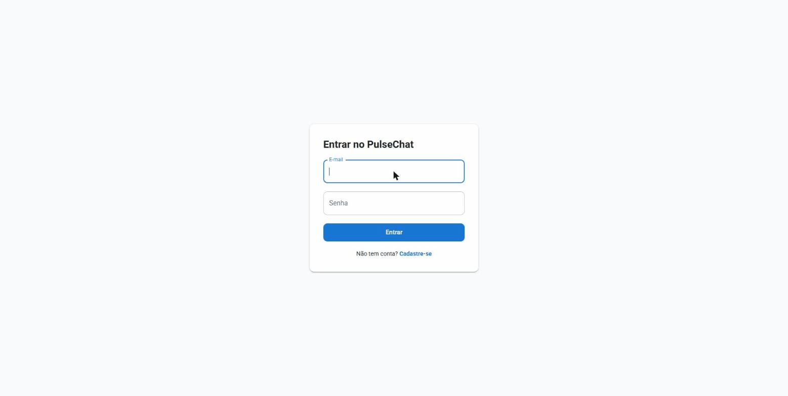
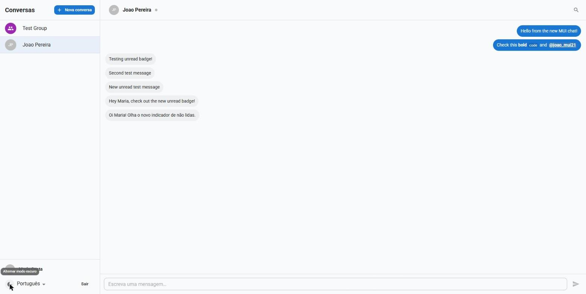
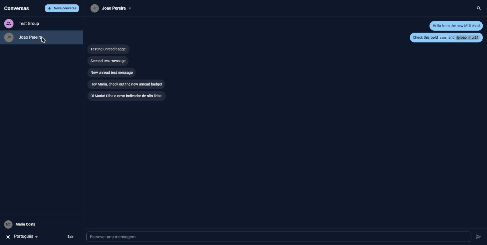
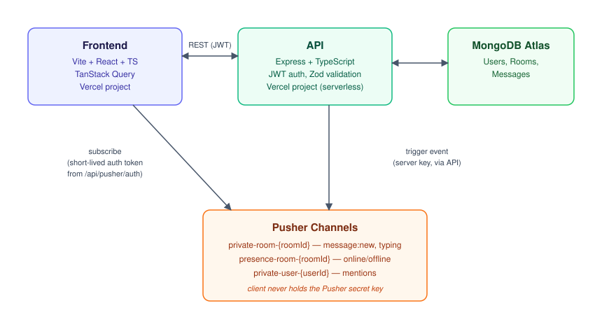

# PulseChat

Real-time chat application with JWT authentication, built as a full-stack engineering
showcase rather than a tutorial clone — real-time messaging over Pusher Channels, typing
indicators, presence, cursor-paginated infinite scroll, read receipts with an unread-count
badge per chat, markdown with syntax-highlighted code blocks, `@mention` highlighting,
message search with `<mark>` highlighting, a Material UI interface with light/dark themes,
Portuguese/English i18n, and integration tests run against a real MongoDB engine.

**Live demo:** https://pulsechat-web-dhenzelnexxus-projects.vercel.app
**API:** https://pulsechat-api-dhenzelnexxus-projects.vercel.app
**API reference:** [`docs/openapi.yaml`](docs/openapi.yaml) ([open in Swagger Editor](https://editor.swagger.io/?url=https://raw.githubusercontent.com/DhenzelNxs/pulsechat/master/docs/openapi.yaml))
**Full technical spec and card-by-card build log:** [`docs/SPEC.md`](docs/SPEC.md)



## Screenshots

| Light mode | Dark mode |
| --- | --- |
|  |  |

## Architecture



The frontend never talks to Pusher's trigger API directly — that would expose the secret
key. It only subscribes to channels with a short-lived auth token issued by
`POST /api/pusher/auth`. All writes go through the API, which persists to MongoDB first,
then triggers the Pusher event. MongoDB stays the single source of truth: a dropped
WebSocket event never causes data loss, just a client that re-syncs on reconnect.

## Stack

| Layer               | Choice                                                                                   |
| ------------------- | ---------------------------------------------------------------------------------------- |
| Frontend            | Vite, React, TypeScript, Material UI (MUI), TanStack Query, React Hook Form + Zod, react-i18next |
| Real-time client    | pusher-js                                                                                |
| API                 | Node.js, Express, TypeScript, Mongoose                                                   |
| Auth                | JWT (access + refresh) + bcrypt                                                          |
| Database            | MongoDB Atlas                                                                            |
| Real-time transport | Pusher Channels                                                                          |
| Testing             | Vitest, Supertest, mongodb-memory-server, React Testing Library, Playwright              |
| CI                  | GitHub Actions — lint, typecheck, test (with coverage), build, on every PR into `master` |
| Hosting             | Vercel — frontend and API as two separate projects from this monorepo                    |

## Local development

Requirements: Node.js ≥ 20, [pnpm](https://pnpm.io), and either a local MongoDB instance
or a free [MongoDB Atlas](https://www.mongodb.com/cloud/atlas) cluster.

```bash
git clone https://github.com/DhenzelNxs/pulsechat.git
cd pulsechat
pnpm install   # installs every workspace and builds packages/shared (via postinstall)
```

Copy the example env files and fill in real values:

```bash
cp apps/api/.env.example apps/api/.env
cp apps/web/.env.example apps/web/.env
```

`apps/api/.env`:

```
MONGODB_URI=mongodb+srv://<user>:<password>@<cluster>.mongodb.net/pulsechat
JWT_ACCESS_SECRET=<generate with: openssl rand -base64 48>
JWT_REFRESH_SECRET=<generate with: openssl rand -base64 48>
PUSHER_APP_ID=<from your Pusher app dashboard>
PUSHER_KEY=<from your Pusher app dashboard>
PUSHER_SECRET=<from your Pusher app dashboard>
PUSHER_CLUSTER=<e.g. us2, eu, ap1>
CORS_ORIGIN=http://localhost:5173
```

`apps/web/.env`:

```
VITE_API_BASE_URL=http://localhost:4000
VITE_PUSHER_KEY=<same Pusher app's public key>
VITE_PUSHER_CLUSTER=<same Pusher app's cluster>
```

Pusher Channels has a free tier — create an app at [dashboard.pusher.com](https://dashboard.pusher.com)
and enable **Client Events** on it (needed for the typing indicator).

Run both apps:

```bash
pnpm --filter api dev    # http://localhost:4000
pnpm --filter web dev    # http://localhost:5173
```

### Checks

```bash
pnpm run lint        # eslint .
pnpm run typecheck   # tsc across every workspace
pnpm run test         # API tests with coverage, then web unit tests
pnpm run build        # builds packages/shared, apps/api, apps/web
pnpm --filter web run test:e2e   # Playwright happy-path spec (needs both dev servers running)
```

These are exactly the steps GitHub Actions runs on every PR into `master` ([`.github/workflows/ci.yml`](.github/workflows/ci.yml)).

## Monorepo layout

```
apps/
  web/     # Vite + React frontend
  api/     # Express + TypeScript backend (deployed to Vercel as a serverless function)
packages/
  shared/  # Zod schemas + types shared by web and api
docs/
  SPEC.md        # full technical spec and the card-by-card work breakdown
  openapi.yaml   # API reference
  architecture.svg
  demo.gif
  screenshot-light.jpg
  screenshot-dark.jpg
```

See [`docs/SPEC.md`](docs/SPEC.md) §4 for the detailed structure and §15 for how the
project was built card-by-card, one PR per card.

## Known limitations

- **Message edit/delete, emoji reactions, file attachments, and PWA/push notifications**
  are stretch goals noted in [`docs/SPEC.md`](docs/SPEC.md) §8 and were out of scope for
  the MVP build.
